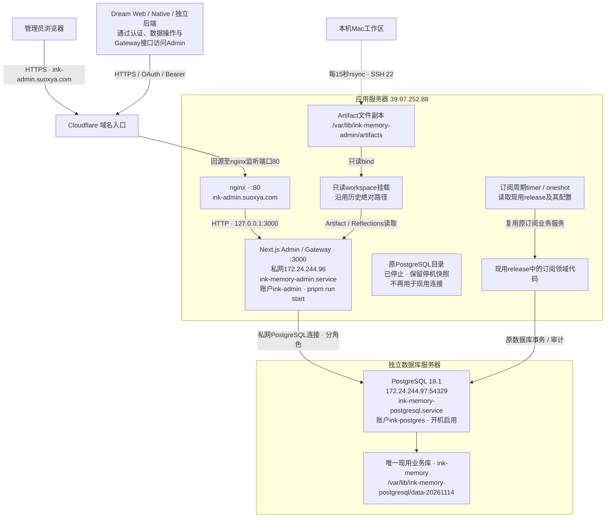
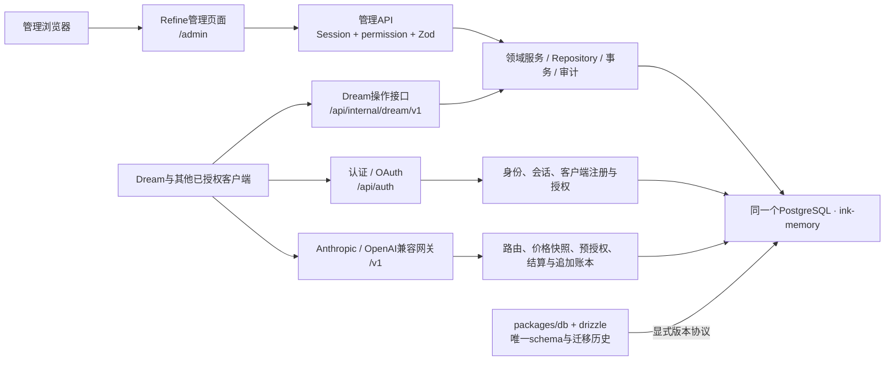
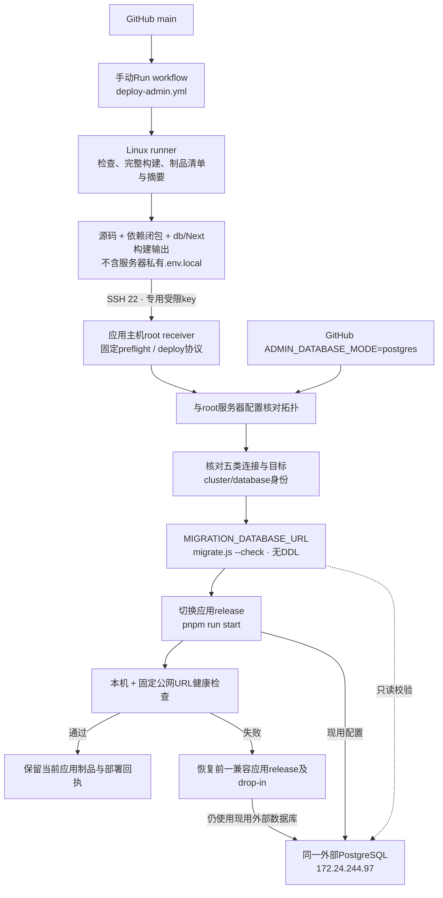
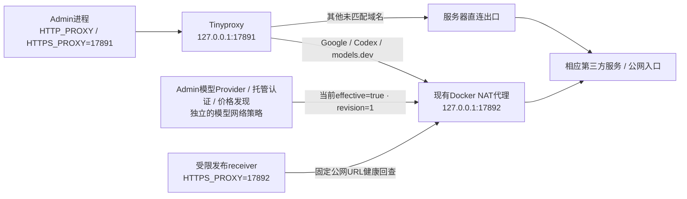
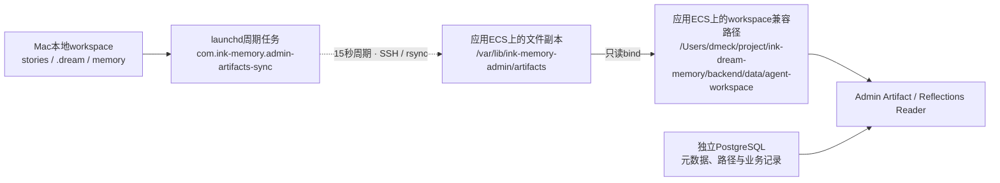

<!-- [Input] 2026-11-14迁移回执、两台主机的只读服务/端口/配置核对、现用模型网络策略及本机同步任务状态。 -->
<!-- [Output] 迁移后的物理部署、业务边界、发布控制、网络出口、文件存储和恢复关系。 -->
<!-- [Pos] Admin现用架构拓扑快照；具体操作沿部署指南，版本与验收沿迁移回执。 -->
<!-- [Sync] 2026-11-14: 数据库独立托管，记录实际启用的模型代理及仍存在的Mac文件同步依赖。 -->
# Admin 部署迁移后的完整架构拓扑

核对日期：2026-11-14，上海时间。应用功能代码为`7cd999efef57b97c20723e56427e8cda677762d0`，BUILD_ID为`OjXS6AYL5vlX7khoH2gms`。后续运维文档已通过PR55合并；文档合并不触发应用部署。

当前为**一台应用服务器、一台独立数据库服务器，以及应用服务器上的网络出口和文件副本**。应用没有迁离原主机；本次完成的是PostgreSQL存储拆分。

## 一、物理部署总图

图中Next.js承载多个业务模块，但仍是同一个应用实例；数据库不在该应用进程组中。停止或重启Admin不会停止目标PostgreSQL。原源库没有连接箭头，因为它只保留为停机快照。

已确认用户入口使用HTTPS，应用主机nginx监听80并设置转发协议为https；本轮没有读取Cloudflare控制台的安全模式或DNS控制面，不能据此进一步断言其控制台选项。

## 二、主机、服务与端口

| 位置 | 组件 | 监听与用途 | 管理方式 |
| --- | --- | --- | --- |
| `39.97.252.88` / `172.24.244.96` | SSH | `22`；运维和受限制品发布 | 原SSH服务；普通运维key与GitHub发布key分开 |
| 同上 | nginx | `80`；域名回源与反向代理 | `nginx.service` |
| 同上 | Next.js Admin / Gateway | `3000`；nginx上游 | `ink-memory-admin.service`，用户`ink-admin` |
| 同上 | 订阅周期推进 | 无监听端口 | `ink-memory-subscription-periods.timer`及对应oneshot |
| 同上 | Tinyproxy | `127.0.0.1:17891`；按域名分流 | `ink-admin-egress.service`，用户`ink-admin` |
| 同上 | 现有Docker NAT代理 | `127.0.0.1:17892`映射到容器`7890` | 已运行容器`ink-admin-egress-tun-proxy-1` |
| 同上 | 应用端口保护 | 限制非回环接口直接访问`3000`与旧`54329` | `ink-admin-local-ports.service`，nftables |
| `172.24.244.97` | PostgreSQL 18.1 | `172.24.244.97:54329`及`127.0.0.1:54329` | `ink-memory-postgresql.service`，用户`ink-postgres` |
| 同上 | SSH | `22`；原应用主机免密运维 | 专用公钥限定来源`172.24.244.96`，允许交互终端 |

应用本身监听3000，并由原主机防火墙保护；它不是依靠Next.js只监听回环实现隔离。数据库通过专用监听、HBA和已核对的私网连通性访问，本轮未修改阿里云安全组或主机防火墙。

两个主机均保持swap禁用、zswap为N；应用与数据库服务均为`MemorySwapMax=0`。应用和数据库均由非root账户运行，SSH运维身份root与运行身份分离。

## 三、应用业务边界与数据库角色

| 连接变量 | 现用SQL角色 | 用途 | 目标 |
| --- | --- | --- | --- |
| `DATABASE_URL` | `ink_memory` | 平台控制面、Gateway、计费等原数据库客户端 | `172.24.244.97:54329/ink-memory` |
| `MIGRATION_DATABASE_URL` | `ink_memory` | 显式迁移身份、版本与发布检查 | 同上 |
| `AUTH_DATABASE_URL` | `ink_auth` | 独立认证客户端、会话与身份合同 | 同上 |
| `ADMIN_CONTROL_DATABASE_URL` | `ink_admin_control` | 管理认证控制事务 | 同上 |
| `DREAM_DATA_DATABASE_URL` | `ink_dream_data` | Dream数据操作与对应权限 | 同上 |

这是五类连接变量和四个现用登录角色，不是五个数据库。迁移保留原角色及权限，没有重新生成加密密钥、OAuth注册或业务实体。浏览器与外部Dream客户端通过公开协议访问Admin；数据库凭据留在服务端。

管理写操作继续走严格校验、事务和审计；Gateway结算继续使用原价格快照与只追加账本。`packages/db/src/schema`及不可变`drizzle`历史仍是唯一DDL来源，数据库主机没有第二套schema管理系统。

## 四、GitHub Actions发布与回滚

- `ADMIN_SSH_HOST`仍为应用服务器`39.97.252.88`；数据库主机不接收Next.js应用制品。
- `ADMIN_DATABASE_MODE=postgres`与root receiver配置一致。目标身份记录在`/etc/ink-memory-admin/github-deploy.json`，私有连接在现用release的`.env.local`。
- 受限入口为`/usr/local/libexec/ink-admin-action-deploy.py`；应用release位于`/srv/ink-admin-releases/`。
- 当前release为`actions-43462851337-7cd999efef57/app`；实际启动命令为`pnpm run start`。
- push、PR、合并只触发检查；发布必须手动触发。普通发布不执行DDL，前向schema升级另走显式流程。
- 应用回滚不能直接带回历史旧数据库地址。应继续携带现用外部配置，不自动降级schema、不把保留的旧源库重新上线。

本次应用部署见[Actions 43462851337](https://github.com/glide-the/dream-im-platform/actions/runs/43462851337)，工作流适配见[PR54](https://github.com/glide-the/dream-im-platform/pull/54)，现用运维合同见[PR55](https://github.com/glide-the/dream-im-platform/pull/55)。

## 五、现用网络出口

当前模型网络策略的**default=false、desired=true、effective=true、revision=1**；数据库记录状态为active，对外策略状态为enabled。服务器已配置`MODEL_EGRESS_PROXY_URL=http://127.0.0.1:17892`。这是本次从现用PostgreSQL读取记录、核对端点并依据原策略合同得到的状态，不能把“默认关闭”写成“当前关闭”。

三种出口配置分别拥有自己的作用范围：

1. 应用systemd的通用HTTP代理指向17891，Node启用`--use-env-proxy`；Tinyproxy对`.googleapis.com`、`.google.com`、`chatgpt.com`、`auth.openai.com`及`models.dev`使用17892上游。
2. 模型中心的revisioned策略由数据库控制，启用时经逐请求dispatcher直接使用17892。它不是改写全局网络环境。
3. 发布key的固定command单独为receiver设置17892及回环`NO_PROXY`，用于公网健康回查；该环境设置不会传成应用systemd的新配置。

现有代理容器只负责网络出口。Admin与PostgreSQL均不是容器部署；本轮没有重建该代理。独立Dream / Agent运行时自己的模型出口未在本次核对范围内。

## 六、Artifact文件与Mac依赖

数据库拆分没有把文件副本搬到数据库主机。当前`FILE_STORAGE_TYPE=disabled`，没有在本次启用新的对象存储。数据库保存原路径及业务记录，文件正文由应用主机的只读workspace路径读取。

本次核对时，Mac的文件同步任务已加载、周期15秒、最近退出码0，进程在两次运行之间处于等待状态；应用主机的只读bind实际存在。这不是共享文件系统，也不证明一批新产物已经完成端到端传输验收。Mac离线或休眠后，不会继续复制新产物；已经位于应用主机的副本仍保留。

旧`com.ink-memory.admin-ecs-relay`只有plist配置，本次查询时未加载，应用主机也没有17890监听。该旧转发不属于现用出口或已确认的访问链路，不应画成正在运行的组件。

## 七、域名与外部Dream边界

| 域名 / 标识 | 应用主机上的配置 | 核对边界 |
| --- | --- | --- |
| `ink-admin.suoxya.com` | nginx转发至`http://127.0.0.1:3000` | Admin现用入口，发布后与迁移后检查通过 |
| `ink-frontend.suoxya.com` | nginx配置转发至`https://dream.suoxya.com:443` | 同时是当前Dream API resource的域名；仅核对转发配置 |
| `ink-backend.suoxya.com` | nginx配置转发至同一Dream上游 | 仅核对转发配置 |
| `dream.suoxya.com:443` | 外部Dream上游 | 未据域名推断其物理主机或进程状态 |

Admin当前认证URL为`https://ink-admin.suoxya.com/api/auth`，Dream API resource为`https://ink-frontend.suoxya.com/api`。外部Dream服务没有在本次部署或重启，不能把上述nginx转发配置解读成Dream运行在Admin ECS内。

## 八、持久化与故障边界

| 对象 | 现用位置 | 故障或恢复关系 |
| --- | --- | --- |
| 唯一现用结构化业务数据 | `172.24.244.97`的`ink-memory`数据库 | 数据库故障时按连接与能力边界失败，不回退到旧库、SQLite或内存数据库 |
| 原源库停机快照 | 应用主机`/var/lib/ink-memory-admin/postgres` | 已停止，保留供明确授权的数据恢复；不是热备或自动故障切换目标 |
| 应用完整制品 | 应用主机`/srv/ink-admin-releases/` | 可按兼容性回滚应用版本；保持同一现用数据库 |
| 私有应用配置及加密密钥 | 现用release的`.env.local`，0600 | 保留原密钥与注册；不进入GitHub制品 |
| 数据库原生运行文件 | 数据库主机`/opt/ink-memory-postgres/18.1` | root拥有；数据库账户可读和执行，数据目录独立0700 |
| Artifact副本 | 应用主机文件目录及只读bind | 新文件依赖Mac周期同步；不随PostgreSQL应用回滚而回退 |
| 网络出口 | 应用主机17891及17892 | 影响相应出站请求和公网发布回查，不改变数据库主机归属 |

本次完成主库位置迁移及停机快照保留，**没有配置数据库自动主备切换，也没有新增定期备份、异地备份或对象存储方案**。图中的旧数据目录不能当作持续更新的备份。

## 九、证据与验证范围

1. [外部PostgreSQL迁移回执](../verification/external-postgresql-cutover-20261114.md)：两次操作、首次保护性恢复、最终checksum差异0、角色与ACL摘要一致、88/88迁移记录、五类连接及受限发布`preflight postgres`通过。
2. [部署指南](../deploy.md)与[服务手册](../deploy-services.md)：现用systemd入口、外部数据库配置、完整数据库unit、发布和恢复合同。
3. 本次只读补充核对：应用/数据库/订阅timer/代理状态、监听端口、nginx路由、Tinyproxy域名规则、已有代理容器、文件只读bind、实际模型网络策略，以及Mac任务加载状态。SSH、策略查询和任务状态核对命令均退出0；旧relay查询返回“未加载”，按观察如实记录。
4. 源码边界：[模型出口策略](../../app/lib/model-egress-policy.ts)、[模型出口执行](../../app/lib/model-egress.ts)、[认证连接](../../app/lib/auth/database.ts)、[受限发布接收器](../../scripts/admin-action-deploy.py)、[手动发布workflow](../../.github/workflows/deploy-admin.yml)。
5. 图文交付校验：五个Mermaid图均通过实际解析与渲染，已导出PNG、SVG及可编辑Mermaid源文件；本地Markdown引用与目录索引检查、`git diff --check`均退出0。图中边界标题和连接标签已检查，修正了初版的多行边界标题遮挡。

本图描述已核对的部署与配置，不把公开登录页或元数据检查写成真实账户、真实模型、Dream远端进程或新Artifact文件的完整业务验收。本轮只整理拓扑，没有修改运行配置、重启服务或触发新的部署。
