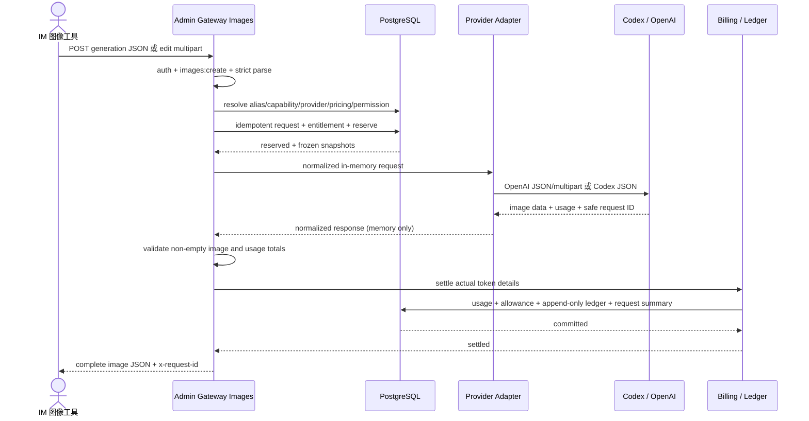
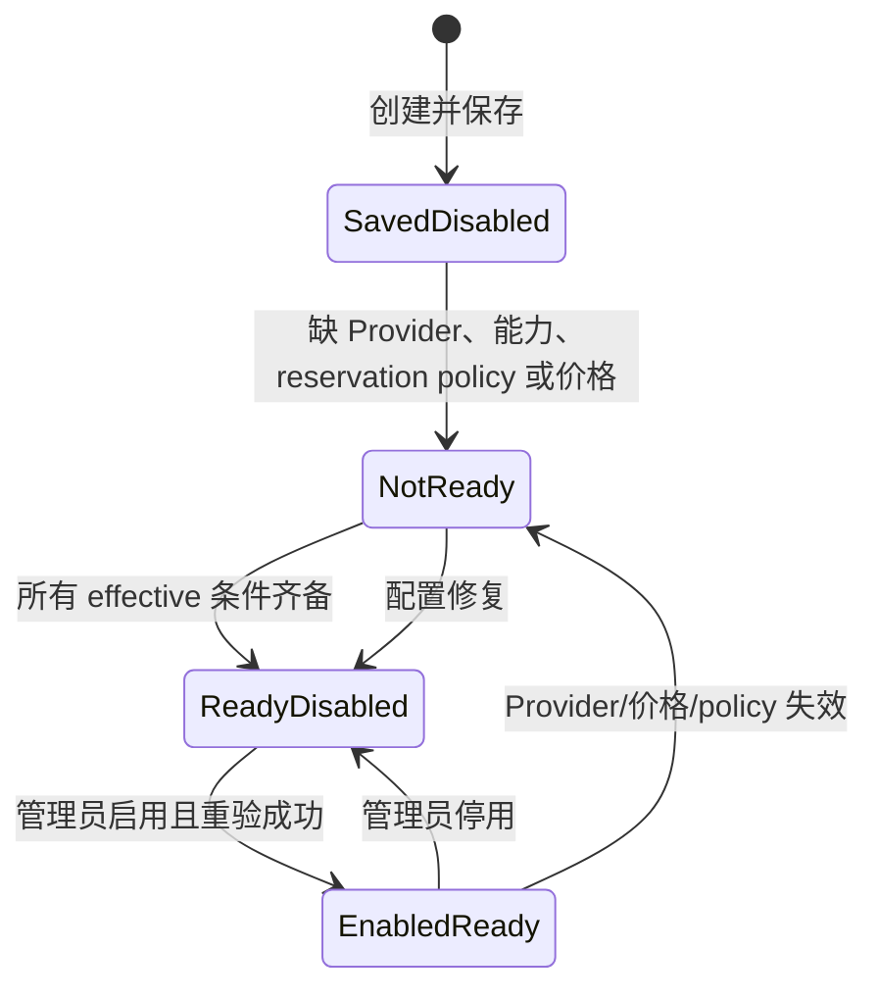
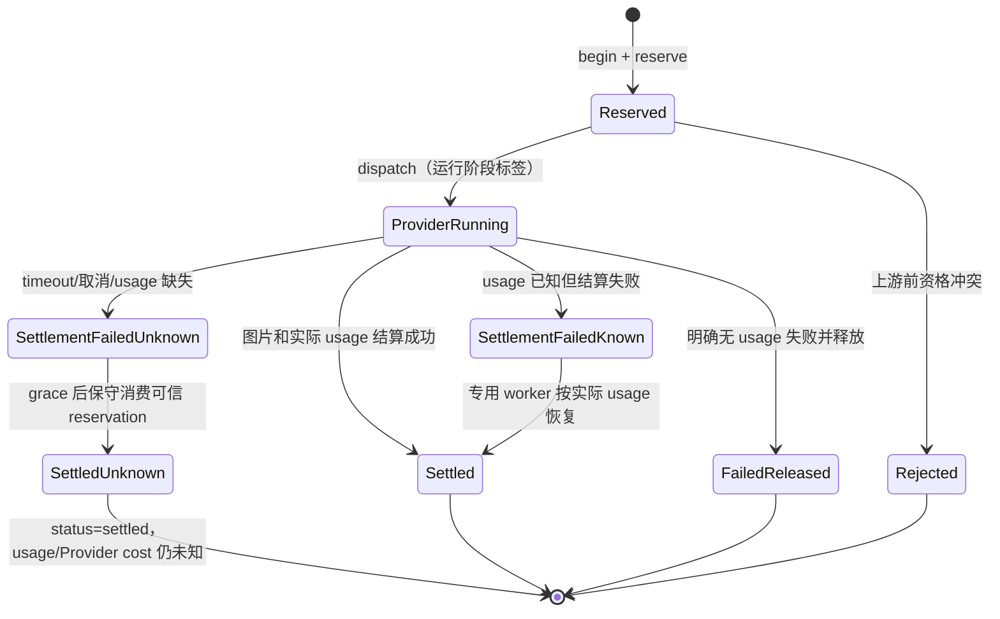

<!-- [Input] Current Image PRD, evidence-tagged source investigation, existing Gateway/Billing contracts, official OpenAI docs, and local Codex source. -->
<!-- [Output] Reviewed implementation design for Image administration, public Images routes, provider adaptation, metering, settlement, and safe observability. -->
<!-- [Pos] Implemented formal design for the Image Model Center; platform settlement is implemented while real OpenAI acceptance remains an external prerequisite. -->
<!-- [Sync] 2026-10-09: reconcile the reviewed design with the landed source, migration, isolated E2E, and remaining real-provider gates. -->
<!-- [Sync] 2026-10-09: record completion of normal-database rollout without conflating it with real-provider acceptance. -->
<!-- [Sync] 2026-10-09: record successful real Codex generation/edit acceptance and the remaining official-OpenAI prerequisite. -->
<!-- [Sync] 2026-10-09: fail closed without auditable reserve/price evidence and record the post-implementation recovery/readiness review. -->
<!-- [Sync] 2026-10-09: enforce a structured Provider-matched Image pricing basis at write and resolve time. -->
<!-- [Sync] 2026-10-09: reject public Image estimates and auto parameters as reservation upper-bound evidence. -->
<!-- [Sync] 2026-10-10: make Admin platform pricing authoritative and keep upstream price provenance optional. -->
# Image 模型中心正式设计

## 1. 背景与问题

现有 Admin 已拥有 Provider、模型 alias、价格版本、Gateway Key、订阅权益、模型权限、请求幂等、预留/结算、请求查询和 append-only ledger。缺少的是图像能力和协议适配，而不是新的控制面。公开 OpenAI Image API 与 Codex 后台 Image API 又存在编辑编码和认证差异，不能把二者当作同一 JSON 接口，也不能把图片请求送入文本 Messages/Chat 转换。

本设计复用现有控制面与生命周期，新增 Image 专用入口、适配和计量字段。2026-10-09 已按独立评审后的最小方案实现；“建议”一词保留为设计形成时的决策语境，当前源码状态以本节、实施状态和验证报告为准。正常业务数据库 migration 已发布，且历史上使用正常 Codex 账户成功取得 generation/edit、usage 与安全请求记录。Admin 版本化 micro-USD 价格是平台结算真值；OpenAI API、models.dev、Codex 公开资料和账号合同只可作为可选参考，不是 Resolver 或 readiness 门槛。Codex included usage 不做逐请求美元换算。真实 OpenAI 仍需官方 OpenAI Provider 和服务器侧凭据，不能由腾讯 Provider 或隔离 fake 替代。

## 2. 目标与边界

### 2.1 目标

- 在 AI 模型中心中管理 Codex/OpenAI Image 模型、能力、价格与请求。
- 对外提供 `POST /v1/images/generations`、`POST /v1/images/edits`。
- 使用上游真实 Token 明细结算，价格与请求都保留不可变快照。
- 不保存 prompt、输入图、mask、输出图、凭据或完整 Image 上游正文。
- 保持现有文本模型、权限、订阅、账本与请求生命周期兼容。

### 2.2 明确不做

- 不改 Claude Code 主循环，不接入 Messages/Chat/Responses adapter。
- 不增加新 Provider 类型、图片资产表、后台任务表、Image 专用账本或自动 Provider failover。
- 不支持流式图片响应；首版只在完整响应结算成功后返回。
- 不把固定模型名、账户、价格、Provider 地址或配额写入业务代码。

## 3. 选定方案与源码依据

### 3.1 选定方案

1. `ai_models.capabilities` 增加约定键 `image_generation`、`image_edit`，不建 Image 模型表。
2. `ai_models` 增加每张输入/输出图片的 Token reservation policy；它只保护预授权，不参与最终计价，也不改变现有文本 `max_output_tokens` 语义。依据复用现有 `metadata.imageReservationSource` 保存，不新增表。
3. `ai_pricing_rules` 增加 nullable 图片输入/输出单价，继续使用现有文本 input/output/cache 价格、版本窗口与 markup/discount；Admin 平台价格直接参与结算。既有 `source/source_ref/source_version/source_metadata` 可选保存参考价格依据，不新增价格表。
4. `gateway_requests` 增加 operation、四类 Image Token 明细和两类图片价格快照；输出数量/格式放入已脱敏 `response_summary`，不建图片请求表。
5. 新增统一的 `images:create` scope；模型能力决定 generation/edit 的细分资格。
6. 新增 Image 专用 handler、严格输入 parser、transport 和 usage parser；复用 auth、model resolve、request begin、subscription/rate limit、settlement 和 error envelope。
7. OpenAI image-marked generic adapter 发送官方 JSON/multipart；Codex adapter 使用 Provider registry 明确拥有的 Image endpoints/headers 发送 JSON。Image 请求不调用现有 text transport。
8. 新增 `/admin/models/images`，内部复用模型、价格和 Gateway 请求组件；创建/编辑仍进入现有全页表单。

### 3.2 依据

- `AIModelRegistry` 已提供模型卡、能力、就绪状态与操作；`AIPricingTimeline` 已提供版本表和结束版本对话框。
- `ai_models.capabilities` 已是 JSON 布尔映射；`ai_pricing_rules`、`gateway_requests` 已是价格和请求事实权威。
- `beginGatewayRequest` 已处理幂等、Subscription、Permission、限流与预留；结算仓储已维护 Usage、Allowance 和 append-only ledger。
- OpenAI 官方 API 生成是 JSON、编辑是 multipart；Codex 源码两者都是 JSON，且复用 active provider/auth。
- 当前通用 text transport 固定拼接 messages/chat 路径，不能安全承载 multipart。

详见 [源码调查与处理判断](../verification/image-model-center-investigation.md)。

## 4. 配置和管理交互

### 4.1 Provider

Image 页只显示两类可用连接：

- `adapter_kind=codex`：Codex managed account。
- `adapter_kind=generic`、`protocol=openai` 且 `config.imageApi.kind=openai`：管理员明确标记的 OpenAI API 连接。

OpenAI 官方 preset 默认写入上述显式配置；自定义兼容端点不自动获得 Image 资格。Provider 写入 schema 严格校验 `imageApi` 对象，resolver 对默认 Provider 和每个 routing candidate 重验。这里不根据 hostname、名称或 code 推断产品，也不把 xAI/GitHub Copilot 当 OpenAI。只有关联模型显式声明 Image 能力时，该连接才进入 Image 就绪摘要。Provider 的创建、凭据、测试、启停仍在现有 Provider 页面。

Codex 不从现有完整 `/responses` URL 做字符串裁剪。Provider registry 为 Codex 明确提供 `imageGenerations`、`imageEdits` 两个 endpoint 和 owned header builder；默认 endpoint、部署 override、endpoint allowlist、配置 fingerprint/test 与 credential renewal 都属于该 registry。

### 4.2 模型

Image 列表查询现有 `models` resource，并按 `capabilities.image_generation=true OR capabilities.image_edit=true` 过滤。创建入口携带 `kind=image`，现有模型表单据此：

- 默认 `chat=false`、`streaming=false`，默认勾选 generation；管理员可调整 generation/edit。
- 只展示与 Image 相关的能力提示，但不隐藏共享 alias、Provider、upstream model、启停字段。
- 服务端仍严格校验 Provider 是 Codex 或 openai/generic，并要求至少一个 Image 能力。
- 编辑普通文本模型时行为不变；为已有模型新增 Image 能力是显式管理员操作。
- generation/edit 能力都要求配置正数的每张输出图片 reservation Token；edit 还要求每张输入图片 reservation Token。`imageReservationSource` 可选记录预算依据，缺少来源只影响审计提示，不阻断启用或调用。reservation 不是价格或实际用量。

模型的有效状态是：模型启用、Image Provider 显式准入且凭据可用、操作能力为真、数值 reservation budget 完整、当前价格版本含对应 Image 平台价格、调用身份具备 `images:create` scope/权益/权限。列表分别展示 Provider、预留、价格与权益四类运行缺口；参考价格和预留来源作为非阻断审计提示，不复用文本模型 readiness，也不把“已保存”写成“可调用”。

### 4.3 价格

现有价格表单按模型能力显示两个新增字段：

- `imageInputPriceMicrousdPerMillion`：每百万图片输入 Token 的整数 micro-USD。
- `imageOutputPriceMicrousdPerMillion`：每百万图片输出 Token 的整数 micro-USD。
- `priceSourceRef`、`priceSourceVersion`：可选的参考价格引用与版本；与来源类型一起填写时形成完整审计三元组。
- `imagePricingBasis`：可选的 `openai_api_usd`、`codex_reference_api_usd` 或 `codex_managed_usd_contract` 标签；填写时 Admin 校验与 Provider 相容，避免把参考价格误称为真实上游合同，但该标签不参与 readiness 或 Resolver。

Admin 平台价格由管理员制定，可直接采用 OpenAI API 或 models.dev 美元 Token 价，也可使用内部定价。Codex managed account 的 included usage 或 credit rate 不构成逐请求美元成本；若管理员采用公开 API 价作为 Codex 平台参考价，应标记为 `codex_reference_api_usd`，不能描述为 Codex 上游实际扣款。只有确实存在独立美元合同的情况才使用 `codex_managed_usd_contract`。

文本 prompt 使用现有 `inputPriceMicrousdPerMillion`；公开直接 Images 的可核验输出类别是图片输出，因此 `outputTextTokens` 必须为零，非零时 fail closed，不能套用文本 output 价。直接 Images 请求不使用 cache read/write。generation-only 模型只要求 image output 价；edit 模型要求 image input 与 image output 价。实际 usage 若出现未配置的类别仍 fail closed。参考来源三元组可全部省略；部分填写时写入拒绝。文本模型继续允许两项 Image 价为 null。调价仍创建新版本，禁止覆盖历史版本。

### 4.4 请求记录

Image 页的“请求记录”复用 `gateway-requests` resource，固定 operation 为 `images.generations` 或 `images.edits`，可再筛模型、Provider、状态和日期。列表/详情增加：

- operation、输入/输出 Token 总量及文本/图片明细；
- 图片输入/输出价格快照、平台基础成本字段、charged、结算状态；其中历史字段名 `provider_cost` 表示平台价格在 markup/discount 前的基础金额，不宣称真实上游账单；
- 输出数量、格式、尺寸、上游安全 request ID；
- 安全错误 code/message，不含上游正文中的 prompt 或图片。

Image request 创建时把 payload capture 状态显式写为 `policy_disabled`，详情固定显示“Image 正文按安全策略未捕获”。`gateway_request_payloads`、`gateway_response_payloads`、SSE event 表均不写入 Image 内容。安全边界同时存在于服务端：Admin payload API 先读取 request operation，Image operation 无论调用者是否有 `gateway.payloads.read` 或确认 header 都返回 policy denial；前端不显示按钮只是对应呈现。

## 5. 公开接口合同

下列新增字段和路由已经实现，错误继续使用现有 `{error, request_id}` Gateway envelope 和 `x-request-id`。正常业务数据库是否具备 capability 由部署 migration 决定；应用不会在启动时建表。

### 5.1 公共约束

- 鉴权：现有 Gateway Bearer/subject 合同。
- Scope：`images:create`。
- 幂等：沿用 `Idempotency-Key`/现有 Gateway 幂等 header 解析；同主体、同 key 不发起第二次调用。
- 模型：请求使用稳定 alias；上游型号只在服务端替换。
- 响应：`application/json`，非流式；结算成功后返回。
- 安全：handler 不调用 request/response payload capture。

### 5.2 `POST /v1/images/generations`

严格 JSON 输入：

```json
{
  "model": "image-alias",
  "prompt": "A quiet ink drawing of a library",
  "n": 1,
  "quality": "medium",
  "size": "1024x1024",
  "background": "auto",
  "output_format": "png",
  "output_compression": 90,
  "moderation": "auto"
}
```

规则：

- `model`、非空 `prompt` 必需。
- 可选值由公开 OpenAI合同和所选 Provider adapter 的 allowlist 校验；未知字段返回 400。
- `n` 为正整数；上传总量、`n`、完整上游 JSON/base64 响应字节数和聚合内存受统一 Image request policy 保护，这些是服务器安全限制，不作为套餐或产品权益展示。
- Codex 当前仅支持 model/prompt/n/quality/size/background；若调用方显式提交 output_format、output_compression 或 moderation，返回 `IMAGE_PARAMETER_UNSUPPORTED`，不静默丢弃。
- 模型必须启用 `image_generation`。

OpenAI 上游：`POST {configuredBase}/v1/images/generations`，Bearer，JSON。若配置 base 已以 `/v1` 结束，只追加 `/images/generations`。

Codex 上游：从 Provider registry 取得明确的 generations endpoint 与 owned auth headers，JSON POST；附带 Gateway request ID 派生的 image turn header，不暴露给调用方。

### 5.3 `POST /v1/images/edits`

严格 `multipart/form-data` 输入：

| 字段 | 要求 |
| --- | --- |
| `model` | 必需，稳定 alias |
| `prompt` | 必需，非空 |
| `image` / `image[]` | 至少一张；使用同一规范化数组，禁止两种命名混用 |
| `mask` | 可选，单张；仅 OpenAI adapter |
| `n`、`quality`、`size`、`background` | 可选 |
| `output_format`、`output_compression` | 可选；Codex 显式拒绝 |

上传只接受可验证的图片 MIME；服务端核对 magic bytes、可解码格式与 MIME，并用中性文件名重建上游 multipart，不转发可能包含个人信息的原始文件名。空文件、混用字段、未知字段和超出服务器资源上限在上游前返回 400/413。资源上限集中在 Image request policy 配置，不散落于页面或 Provider adapter。

OpenAI 上游：重建新的 multipart，替换上游 model，转发规范化图片、mask 和允许字段；不转发客户端原文件名或任意客户端 headers。

Codex 上游：在内存中把已验证上传编码为 data URL `ImageReference`，发送 JSON `images` 数组；mask 返回 `IMAGE_PARAMETER_UNSUPPORTED`。不将 data URL 持久化、记录或放入错误上下文。

模型必须启用 `image_edit`。

### 5.4 成功响应

Gateway 返回 OpenAI-compatible JSON：

```json
{
  "created": 1778832973,
  "data": [{ "b64_json": "...", "generation_id": "optional" }],
  "background": "opaque",
  "quality": "medium",
  "size": "1024x1024",
  "output_format": "png",
  "usage": {
    "input_tokens": 1474,
    "input_tokens_details": { "text_tokens": 17, "image_tokens": 1457 },
    "output_tokens": 1372,
    "output_tokens_details": { "text_tokens": 0, "image_tokens": 1372 },
    "total_tokens": 2846
  }
}
```

转换规则：

- 保留安全、兼容的结果字段；Codex 的 `generation_id` 可原样返回。
- `data` 必须非空，且每项必须含非空 `b64_json`；否则按 `IMAGE_RESULT_INVALID` 失败，不产生成功结算。
- usage 必须存在且为非负安全整数。输入 text/image 明细必须存在并与 input total 相符；缺失时 fail closed。官方直接 Images 的 output detail 是可选字段：缺失时规范化为 `outputImageTokens=outputTokens`、`outputTextTokens=0`；存在时必须与 output total 相符且 text output 必须为零。total 也必须等于 input + output；不一致或非零 output text 按 `IMAGE_USAGE_INVALID` 进入 settlement_failed。未来只有 Provider 合同和价格单位同时扩展后才能接纳 output text。
- 响应对象只在内存中保留到结算结束；不写 payload 或审计详情。

## 6. 分层职责

| 层 | 职责 | 禁止 |
| --- | --- | --- |
| 前端 | Image 导航、筛选、能力/价格/请求摘要、复用表单 | 不接触 Provider secret、prompt、图片正文 |
| Admin API | Session + permission 重验、严格 schema、事务、审计 | Route Handler 不写复杂 SQL/结算逻辑 |
| Gateway | 身份/scope、模型能力、幂等、预留、transport、结果校验、结算、错误映射 | 不进入 text adapter，不捕获 payload |
| Provider adapter | URL、认证、JSON/multipart 转换、上游响应读取 | 不选择价格/权限，不做跨 Provider retry |
| Billing | 价格快照、四类 Image Token 计价、Allowance 与 ledger 原子结算 | 不按张数推算、不修改旧账 |
| PostgreSQL | 唯一 schema、请求/usage/ledger/审计事实 | 不运行时建表、不设 SQLite/JSON 回退 |

## 7. 身份、授权和模型解析

顺序保持现有生产合同：

1. 验证 Gateway key 或 runtime delegation，得到 canonical platform user。
2. 检查 `images:create`；失败不创建可关联业务正文。
3. 用 alias 解析启用 Model 和 Provider。
4. 校验 operation 对应能力及 adapter：Codex 或 openai/generic。
5. 解析有效价格版本和模型 reservation policy；按 generation/edit 实际需要的价格或 budget 缺失即 fail closed。
6. 检查 Subscription/Entitlement、Model Permission、RPM/Token limit 和 Allowance。
7. 在同一幂等事务建立 request、冻结配置/价格并预留。

对 runtime delegation，`gateway-cli` 的 scope allowlist 同步增加 `images:create`；这只是让通用 delegation create 显式请求的短期委托可以携带该 scope，不自动扩大任何已存在委托或 Gateway Key。Story confirmation claim-turn 与 task-result claim 是已经登记的冻结 Dream operation，继续使用原 delegation 输出 enum，其自动签发的 Gateway 授权也仍只有 `messages:create`、`messages:count_tokens`、`models:list`。实现影响面同步覆盖 `app/lib/auth/config.ts`、`app/lib/gateway/service-key-rotation.ts`、`app/lib/auth/delegationDto.ts`、`app/lib/auth/delegationService.ts`、`app/lib/subscriptions/contracts.ts`、`app/lib/product/contracts.ts`、Product service/repository 的 operation→scope 映射，以及 Admin Gateway Key/Entitlement 表单。

## 8. 数据与 migration

使用前向 PostgreSQL migration `0078_absent_puppet_master.sql`，capability 为 `gateway.images.v1`。0000–0077 SQL、snapshot、journal tag/when/hash 保持不变。0078 按 expand → compatibility backfill → validate → contract 排列，并在最后发布 capability。

### 8.1 `ai_models`

- `image_input_token_reserve_per_image bigint NULL`
- `image_output_token_reserve_per_image bigint NULL`
- 非负 constraint 先以 `NOT VALID` 增加，验证后再作为 effective readiness 依据。

这些值是 Provider/model 公开上界或运营核实后的预授权 policy，只用于 reserve；最终用量和价格永远来自上游 usage。旧模型保持 null，文本路径不读取。

### 8.2 `ai_pricing_rules`

- `image_input_price_microusd_per_million bigint NULL`
- `image_output_price_microusd_per_million bigint NULL`
- 非负 check。

现有行保持 null；无数据回填。应用兼容阶段允许文本模型继续使用旧价格；Image 模型解析时要求非 null。

### 8.3 `gateway_requests`

- `operation text NOT NULL DEFAULT 'text'`，check：`text|images.generations|images.edits`。
- `input_text_tokens bigint NULL`
- `input_image_tokens bigint NULL`
- `output_text_tokens bigint NULL`
- `output_image_tokens bigint NULL`
- `image_input_price_snapshot bigint NULL`
- `image_output_price_snapshot bigint NULL`
- 所有数值非负 check。

旧行以 `text` 保持语义。聚合 `input_tokens/output_tokens/total_tokens` 继续用于现有报表和 Allowance；Image 明细用于价格和诊断。输出数量、format、size、输入图片数量/媒体类型/总字节数只进入脱敏 JSON summary，不新增固定列。

### 8.4 scope check

前向 migration 更新 runtime delegation 的数据库 check，允许 `gateway-cli` 使用 `images:create`。这是 contract 变更，必须有 schema contract test；不会改写已存在 scopes。

### 8.5 expand → compatibility → backfill → validate → contract

1. **Expand**：添加 nullable model/pricing/request 列；`operation` 先 nullable 或带兼容 default；添加 `CHECK NOT VALID`；新应用仍能读取旧行。
2. **Application compatibility**：部署能同时处理旧行 null 与新行的代码。旧应用插入 request 时由数据库 default 得到 `text`，新增价格/model 列均可省略。
3. **Backfill**：只把历史 `gateway_requests.operation` 明确回填为 `text`；不为旧模型/价格虚构 Image policy 或价格。
4. **Validate**：验证非负、operation allowlist 和 runtime delegation scope check；先安装包含 `images:create` 的新 check，再移除旧 check，避免无约束窗口。
5. **Contract**：在 backfill/validation 后把 operation 收紧为 `NOT NULL DEFAULT 'text'`，发布 capability。旧应用仍可插入文本请求；新 Image 应用启动只检查 capability。

### 8.6 capability 顺序

DDL、check 替换和必要索引全部成功后，最后写入 capability ledger。应用启动只检查 capability，不执行 migration。

## 9. 用量、预留与结算

### 9.1 价格公式

设价格均为 micro-USD / 1,000,000 tokens：

```text
providerCost = ceil(inputText * inputTextPrice / 1e6)
             + ceil(inputImage * inputImagePrice / 1e6)
             + ceil(outputImage * outputImagePrice / 1e6)
charged = ceil(ceil(providerCost * (10000 + markupBps) / 10000)
               * (10000 - discountBps) / 10000)
```

每个 component 使用现有整数向上取整策略。首版要求 `outputText=0`；直接 Images 的 cache tokens 固定为零且不参与价格。总 Token 与明细不一致时拒绝结算，不能选一个“看起来合理”的字段。

### 9.2 预留

不根据图片字节数发明 Token 公式，也不改变文本 `max_output_tokens` 语义。Image 预留使用模型上显式、可审计的 per-image policy：

```text
reservedTokens = estimatedPromptTextTokens
               + inputImageCount × imageInputTokenReservePerImage
               + n × imageOutputTokenReservePerImage
```

edit 的 mask 若作为上游图片输入参与计量，也计入 `inputImageCount`。generation 要求 output budget；edit 同时要求 input/output budget。缺少数值 budget 的模型不能进入 Image effective-ready。最终实际 Token 可能与预留不同，完整图片必须保留在请求内存中，直到 Allowance/账本按实际 usage 原子结算成功。

官方 Image 计算器和尺寸/质量 Token 表只提供估算，不保证绝对上界；本机 Codex extension 对 generation/edit 都发送 `quality:auto`、`size:auto`。管理员据容量和并发保护需要配置 reservation budget，并可用 `imageReservationSource` 记录依据。系统不把该预算冒充实际 usage 或结算用量；来源缺失不阻断调用。

Image settlement 启用 `requireFullTokenAllowanceCapture`：若 allowance 实际 capture 少于 `actualTokens`，整个结算事务回滚，返回额度/结算错误，不释放图片结果。现有文本结算行为保持不变。reservation 只保护并发额度，绝不作为实际 usage 或 Provider cost。

### 9.3 结算

- 成功且 usage 完整：写 usage、四类明细、request 汇总、Allowance capture/release、Provider cost、charged 和 append-only ledger，事务成功后返回图片。
- 明确上游 4xx 且确认未产生 usage：按失败释放预留，不收费。
- 上游 5xx 若带可信 usage：按 usage 结算并返回安全失败；无 usage 则 settlement_failed。
- usage 缺失/错误、网络中断、timeout、client cancel：先为 `settlement_failed` 且 `usage_known=false`，不记零 Provider cost/charged、不自动再次调用。可信全上界 reservation 在既有 grace 后由保守 worker 幂等消费 Token allowance、写 `settled_at` 并把持久状态转为 `settled`；该动作只表达风险额度消费，不能写四类实际 usage、不能推断 Provider cost，也不能把 usage 状态改为已知。
- 上游已返回合法 usage、但结算事务失败：单独持久化四类 Token、upstream request ID、安全 response summary 和 `usage_known=true`；专用幂等 recovery 用这些事实重新执行结算，绝不重新请求图片。
- 已知 usage 的恢复完成后，请求和账本可审计，但原图片已被扣留且不持久化，不能向原调用重放；调用方收到原 request ID 并自行决定是否发起新的业务请求。

## 10. 失败、取消、重复与重试

| 场景 | 处理 | 是否调用/重试上游 |
| --- | --- | --- |
| 无认证或 scope | 401/403 安全错误 | 不调用 |
| 模型不存在/停用/能力不符 | 404/409/400，记录安全摘要 | 不调用 |
| Provider/价格/权益未就绪 | 503/403/402 | 不调用 |
| multipart 或字段错误 | 400/413 | 不调用 |
| 相同幂等 key 正在执行/已终结 | 409 指向原 request ID | 不再次调用；不重放图片正文 |
| OpenAI/Codex 明确 4xx | 保存脱敏 code/request ID，释放预留 | 不自动重试 |
| managed Codex access token 的确定性 401 | 允许现有 credential renewal 一次；401 表示请求未获授权 | 只在 token 轮换成功后重发一次，记录 renewal attempted |
| 429/5xx | 返回 Retry-After/安全失败 | Gateway 不自动重试；调用方以新业务决策重试 |
| timeout/network/cancel | settlement_failed；不返回图片 | 不重试、不 failover |
| data 空、缺 b64 或 b64 无效 | 拒绝结果并扣留图片；若 usage 仍完整可信则按实际用量结算失败请求，否则进入 unknown usage | 不重试 |
| usage 缺失/矛盾 | `IMAGE_USAGE_INVALID`/`IMAGE_USAGE_MISSING`，`usage_known=false`；grace 后保守消费可信 reservation，Provider cost/charged 与实际明细保持未知 | 不重试、不重发 Provider |
| 账本/Allowance 提交失败且 usage 已知 | 持久化四类 Token 与安全摘要，`usage_known=true` | 专用 worker 只重做实际 usage 的幂等结算，不重发 Provider 请求 |

“停止”是客户端 abort：若上游尚未 dispatch，可安全释放；dispatch 后无法证明上游未执行，按未知 usage 处理。

## 11. 正常业务时序



## 12. 异常与恢复时序

```mermaid
sequenceDiagram
    actor Caller
    participant GW as Images Gateway
    participant DB as PostgreSQL
    participant UP as Provider
    participant REC as Settlement Recovery

    Caller->>GW: request + idempotency key
    GW->>DB: begin/reserve
    alt duplicate request
        DB-->>GW: in_progress/completed original ID
        GW-->>Caller: 409, no image replay
    else preflight rejected
        DB-->>GW: rejected
        GW-->>Caller: safe 4xx/5xx
    else dispatched
        GW->>UP: one image request
        alt definitive 4xx, no usage
            UP-->>GW: safe error
            GW->>DB: release + failed
            GW-->>Caller: mapped error
        else timeout/cancel/missing usage
            UP--xGW: outcome or usage unknown
            GW->>DB: settlement_failed + usage_known=false
            GW-->>Caller: safe failure + request ID
            REC->>DB: grace 后保守消费可信 Token reservation
            Note over REC,UP: usage remains unknown; no Provider cost or image retry
        else valid image, settlement commit fails
            UP-->>GW: image + usage in memory
            GW->>DB: settle transaction fails
            GW->>DB: persist safe usage facts + usage_known=true
            GW-->>Caller: settlement error; image withheld
            REC->>DB: idempotently settle persisted actual usage
            Note over REC,UP: never resend image request or persist image
        end
    end
```

## 13. 页面与业务状态转换

### 13.1 模型配置与派生就绪状态



以上 `NotReady/ReadyDisabled/EnabledReady` 是页面依据现有事实计算的派生 UI 状态，不新增数据库状态机；持久化事实仍是现有 model/provider/pricing 字段与审计。

### 13.2 Gateway request 持久化状态



`Reserved/settled/rejected/settlement_failed` 对应现有请求状态；`ProviderRunning`、`FailedReleased`、`SettlementFailedKnown/Unknown`、`SettledUnknown` 是图中解释标签，known/unknown 由实际 usage 字段与安全 summary 区分，不声称新增同名数据库枚举。

## 14. 对现有系统的影响

### 14.1 文本模型

- 原 capability、route、handler 和 text transport 不变。
- 新价格列 nullable；旧价格和旧模型无需回填。
- `operation='text'` 默认保持旧查询、报表和历史语义。
- 通用 `calculateCharge` 继续处理文本；Image 使用扩展明细分支，必须有文本回归。

### 14.2 权限与产品

- Gateway Key、OAuth auth scope、service-key rotation、通用 runtime delegation、Subscription entitlement 与 Product query/service/repository 增加 `images:create` 的显式映射；已冻结 Dream operation 的嵌套 delegation DTO 和自动授权范围不变。
- 已有 key/plan 不自动获得该 scope；管理员显式修改或新建。
- `GET /v1/models` 增加 endpoint-specific capability/availability：Image-only 模型可发现其 generations/edits 可调用性，但保留现有文本 `callable`、`messages:create` entitlement 和 `default_model_alias` 语义，不把 Image-only alias 选成 Messages/Chat 默认模型。Product usage/query 按 request operation 映射 scope，不能继续把全部 openai protocol 记为 `chat:create`。

### 14.3 请求与账单

- 现有请求页能查询 Image operation；Image 详情强制无 payload。
- 聚合 Token/金额保持现有报表兼容，明细列提供准确成本解释。
- Ledger 仍只追加；不新增 Image ledger 类型，沿用 request charge/refund 事实与 request ID。

## 15. 验收矩阵

| 编号 | 场景 | 预期证据 |
| --- | --- | --- |
| A1 | Provider marker → Image 模型/reservation budget → Image 平台价格 → 启用 | Admin 页面/API 成功，effective 就绪；缺数值预算/价格或 custom generic 时 fail closed，缺可选来源只显示审计提示 |
| A2 | 授权 generation | OpenAI/Codex fake transport 收到正确协议；返回 b64；结算/请求摘要一致 |
| A3 | 授权 multipart edit | OpenAI 收 multipart；Codex 收 JSON data URLs；返回 b64；正文未持久化 |
| A4 | scope/权益/模型权限拒绝 | 上游调用数为 0，状态码和 request 记录符合阶段 |
| A5 | 模型停用/能力不符/无价格 | fail closed，上游为 0 |
| A6 | 无效 JSON/multipart/MIME/字段 | 400/413，安全错误，不落图片正文 |
| A7 | 上游 4xx/5xx/空 data/错误 data | 正确 release 或 settlement_failed；无成功账单 |
| A8 | usage 缺失/总量矛盾 | settlement_failed，不返回图片；grace 后只保守消费可信 Token reservation，usage/Provider cost 不显示为 0 或已知 |
| A9 | 重复请求 | 同 key 只调用一次、只结算一次；后续 409 指向原 request |
| A10 | cancel/timeout/结算失败 | 不重试、不 failover、不泄漏结果；known usage 按实际明细恢复，unknown usage 仅在 grace 后保守消费可信 reservation 并保持用量/费用未知 |
| A11 | 请求详情 | 能看 operation/usage/cost/error；任何权限都看不到 prompt/图片/payload |
| A12 | 文本回归 | Messages/Chat/Models、text pricing、Allowance、ledger 测试不变 |
| A13 | migration | 从 0077 按 expand/compat/backfill/validate/contract 前向应用，capability 最后发布、重复 runner 安全、旧行保持 text/null |
| A14 | 桌面/390px Chrome | 栏目、卡片、表单、价格、请求表和详情滚动可用 |
| A15 | 真实 Codex | 用户指定正常账户/模型经正常入口完成生成、编辑、Admin 可见实际 usage、平台价格结算、Allowance/Ledger 与无 payload；不要求 included usage 的逐请求美元换算 |
| A16 | 真实 OpenAI | 官方 OpenAI Provider/服务器凭据经正常入口完成生成、编辑和 Admin 可见结算；当前缺外部前置，单独报告 |

## 16. 实施顺序

1. 修订文档并完成独立评审。
2. 添加 Drizzle schema、前向 migration、capability 和 contract tests。
3. 扩展 billing types/算术/usage persistence，并先完成纯函数测试。
4. 扩展 scope、model resolver 与 request repository 快照。
5. 实现严格 Image schemas、OpenAI/Codex transports、handler 与 routes。
6. 实现 Admin resource 字段、Image 页面、表单上下文和安全请求详情。
7. 完成 provider-free unit/integration、隔离 PostgreSQL、focused Chrome E2E 和文本回归。
8. 主执行者在具备用户指定真实账户/模型时执行正常业务验收；否则明确保持未验证。

## 17. 过度设计检查

选定方案只在现有模型上增加两项 reservation policy、现有价格上增加两项价格、现有请求上增加明细/operation，再补一个 scope、一个页面组合和两条 route；没有新业务表、队列、资产系统、画布、第二账本、Provider 抽象重写或环境分支。Provider `config.imageApi` 和 Codex registry endpoints 只表达实际协议所有权。Image 专用 transport 与 known-usage recovery 分支分别由 multipart/JSON 差异和不能用 reservation 冒充实际用量所必需，不是重复 Gateway 生命周期。
