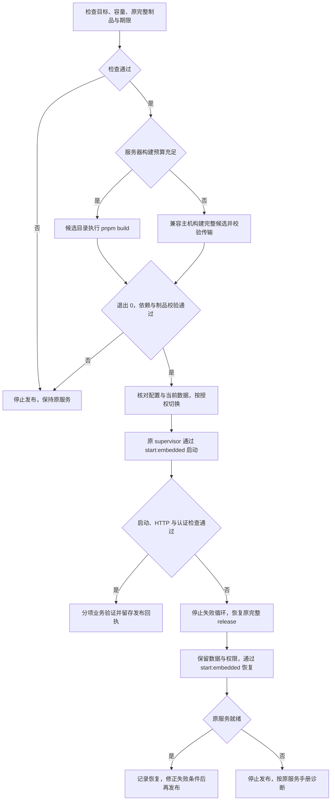

<!-- [Sync] 2026-11-08: 当前发布器已验证，PR与手动发布共享receiver合同；11-02调查原文保留。 -->
<!-- [Sync] 2026-11-08: 用户授权GitHub手动发布，当前按deploy.md完整Linux制品流程执行；保留原构建事故与恢复规则。 -->
<!-- [Input] Admin package/Next 配置、既有 ECS 服务手册、发布事故记录及 Node/systemd 官方资料。 -->
<!-- [Output] 构建资源检查、构建与运行入口选择、原制品恢复和完成判定操作要求。 -->
<!-- [Pos] Admin 发布专项手册；与 deploy.md、deploy-services.md 配套。 -->
<!-- [Sync] 2026-11-02: 明确低内存构建风险、重复重启构建风险及不重新构建的恢复条件，仅修改文档。 -->

# Admin 构建内存与发布失败恢复

## 背景与问题

2026-11-02 的[Dream 侧事故记录](../../ink-dream-memory/docs/exec/ios-account-entry-fix-20261102.md)报告 Admin 原 Node 堆上限为 2048 MiB、服务器 `MemTotal` 约 1607 MiB，构建期间出现公网 502 与 SSH 超时。后续一次 512 MiB 堆构建日志明确出现 V8 heap 耗尽、worker SIGABRT，所观察 memcg 的 `oom=0`。堆配置超预算、V8 堆耗尽和内核 OOM 分别记录，连接超时仅作为症状。

512 MiB 堆与 900 MiB 初始构建限额属于该次尝试参数，未形成通用容量标准。后续构建结果以相应发布回执为准。本轮仅核对本地源码、现有文档和历史记录，未查询线上当前状态。

## 目标与边界

发布前确认资源预算，故障时恢复已验证制品，避免自动重启反复执行失败构建。保留正常登录、现有 Client/PKCE/Cookie、权限、Gateway 和 PostgreSQL 数据。

本文只维护文档、索引与 `AGENTS.md`。不执行构建、安装、SSH、服务启停、配置调整、数据操作或发布；文中的操作模板供后续已授权维护使用。Dream 对应说明见其[专项手册](../../ink-dream-memory/docs/deploy/build-memory-and-recovery.md)。

## 当前发布合同（2026-11-08）

普通Admin发布在GitHub手动Run workflow中完成锁定安装、Node打包合同、`pnpm test:release-receiver`、单元／lint／完整类型与构建。receiver合同由PR CI及手动发布共享；ECS只执行完整制品校验、显式check-only迁移检查与原`start:embedded`切换。当前步骤及失败重试归[发布指南](deploy.md)，已执行回执归[采用记录](verification/chat-continuation-20261108.md)。

下节调查表和原方案保留2026-11-02调查时点；其中“无通用制品上传发布器”为历史事实。现用Actions接收器已验证，服务器资源不足时保持原完整制品，禁止回到原地源码构建或通过交换增加预算。

## 当前代码事实与处理判断

| 当前事实与证据 | 操作影响 |
| --- | --- |
| [package.json:26](../package.json#L26) 的 `start:embedded` 为 `tsx packages/db/src/supervise.ts pnpm start`；[同文件:27](../package.json#L27) 的 `local:stable` 为 `pnpm build && pnpm run start:embedded` | 源码发布入口包含构建；已有完整制品的恢复可复用 `start:embedded`，无需再次编译 |
| [package.json:28](../package.json#L28) 构建 db package 后执行 `next build --webpack`；[同文件:29](../package.json#L29) 使用原 Next stdio guard 启动 | 兼容制品须含 db 输出、Next 产物、完整运行依赖及启动脚本；仅上传 `.next` 无法证明可运行 |
| [next.config.js:16](../next.config.js#L16) 接收 `NEXT_BUILD_CPUS` 与 `NEXT_WEBPACK_MEMORY_OPTIMIZATIONS`，显式启用独立 Webpack build worker | 复用已有开关并保留类型检查，所有 worker 计入构建预算 |
| [packages/db/src/supervise.ts:11](../packages/db/src/supervise.ts#L11) 拒绝启动时 migration；[同文件:18](../packages/db/src/supervise.ts#L18) 启动 PostgreSQL 并负责收尾 | 恢复仍沿同一 supervisor；禁止另起 PostgreSQL、切换数据源或借恢复执行 migration |
| [服务手册](deploy-services.md) 记录 `local:stable`、2048 MiB 堆和 systemd OOM 自动重启策略 | 单纯 restart 可重复进入构建；以实时 `ExecStart` 与有效覆盖项核对实际行为 |

2026-11-02历史方案收敛：保留 `local:stable` 源码发布入口与现有 `start:embedded` 运行入口，通过操作流程区分构建、切换和恢复。资源不足时优先评估兼容构建主机；现有 ECS 无通用制品上传发布器，本轮不新增脚本、服务或发布中台。

## 概念与规则

- V8 `--max-old-space-size` 仅限制 old space；young generation、原生内存、Buffer、线程栈和子进程另占内存。接近上限会增加 GC 时间。[Node CLI](https://nodejs.org/api/cli.html#--max-old-space-sizesize-in-mib)
- systemd `MemoryMax` 作用于 unit 内进程组，祖先 cgroup 可进一步收紧有效额度；Node 堆值低于该限额仍需为其他内存预留容量。[systemd 资源控制](https://www.freedesktop.org/software/systemd/man/latest/systemd.resource-control.html)
- 构建预算覆盖所有构建进程峰值、同时运行的服务/数据库和系统余量；结合 `MemAvailable`、有效 cgroup 限额及已测峰值判断。限额不提供额外物理容量，降低堆不保证构建成功。
- ECS 继续禁用 swap/zswap，保持 `MemorySwapMax=0`。禁止以交换、无限提高堆、跳过类型检查或并行重试绕过容量不足。
- 构建失败后先修正已确认条件，再发起下一次有期限的尝试。发现自动重启重复构建时，按已授权恢复流程停止该失败循环，保留其他服务。

## 发布前最小检查

以下只读命令在已确认 ECS 私有终端执行，服务名来自现有手册；目标仍须核验。本轮未执行。

```bash
date -Is
uname -m
free -m
swapon --show
df -h .
systemctl show ink-memory-admin.service \
  -p WorkingDirectory -p User -p MainPID -p ControlGroup \
  -p ActiveState -p SubState -p NRestarts \
  -p MemoryCurrent -p MemoryHigh -p MemoryMax -p EffectiveMemoryMax \
  -p MemorySwapMax -p OOMPolicy -p Restart \
  -p Result -p ExecMainCode -p ExecMainStatus
```

预期取得实际 release、运行账户、状态及资源限制。旧 systemd 缺少属性时核对该机支持的字段与 cgroup 文件。私下检查 `ExecStart`、drop-in 及 `NODE_OPTIONS` 的实际来源，只记录堆相关选项；禁止输出整个 Environment、`.env.local`、进程环境、完整命令行或数据库连接串。

需要定位 OOM 时，在同一故障时间范围查看目标 unit 与内核日志，并由 `ControlGroup` 确定 cgroup v2 路径：

```bash
# 私有查看；分享前去除凭据、回调参数与业务正文。
journalctl -u ink-memory-admin.service --since '10 minutes ago' -n 120 --no-pager
journalctl -k -b --since '10 minutes ago' --no-pager
admin_cgroup=$(systemctl show ink-memory-admin.service -p ControlGroup --value)
if [ -n "$admin_cgroup" ] && [ -r "/sys/fs/cgroup${admin_cgroup}/memory.events" ]; then
  cat "/sys/fs/cgroup${admin_cgroup}/memory.events"
fi
```

重启后调查前次故障需核对 boot ID 与日志时间，不能用当前开机无记录排除前次 OOM。`memory.events` 是累计计数，应比较本轮前后差值并关联日志。[Linux cgroup v2](https://docs.kernel.org/admin-guide/cgroup-v2.html)

放行条件：目标身份、现用数据目录、运行账户、恢复制品、完整依赖、构建预算、执行期限均明确。任一项缺失时停止发布，保持可用服务；禁止在现用 release 原地覆盖构建输出。

## 构建位置与制品要求

| 路径 | 适用条件与操作 |
| --- | --- |
| 兼容本地/CI 主机构建 | 服务器余量不足时优先评估。核对目标 OS、架构、libc、Node ABI、pnpm/锁文件及原生模块，生成完整项目候选；保留 `start:embedded` 所需 TypeScript、tsx、workspace 链接和 db 输出。Mac `node_modules` 直接复制到 Linux 禁止上线 |
| 目标服务器构建 | 预算可覆盖构建与现有服务；在独立候选目录使用原 `pnpm build`。沿用 `NEXT_BUILD_CPUS`、内存优化选项及完整类型检查，配置与该次预算匹配的堆和进程组上限 |
| 已验证制品恢复 | 原完整 release、依赖及 `.next/BUILD_ID` 均可用，源码/制品匹配，使用原配置和现用 PostgreSQL；直接复用 `start:embedded`，跳过重新构建 |

完整依赖包含根 workspace 与 `packages/db` 的解析闭包；只建立根 `node_modules` 链接不能证明子包依赖可解析。私有 `.env.local` 保持原密钥、权限和运行账户，不打进通用制品。

`NEXT_STANDALONE_OUTPUT` 属于已有可选配置；ECS 的内嵌数据库 supervisor 仍需要完整项目，不能用 standalone `server.js` 替换 `start:embedded`。Next.js standalone 的追踪资源与静态目录要求见[官方 output 文档](https://nextjs.org/docs/app/api-reference/config/next-config-js/output)。

每次构建记录开始时间、期限、明确的 unit/进程组与恢复入口。`Type=oneshot` 使用 `TimeoutStartSec` 限制启动阶段；`RuntimeMaxSec` 对该类型无效。外部 watcher 须与本次构建绑定，恢复前确认其已结束。[systemd.service](https://www.freedesktop.org/software/systemd/man/latest/systemd.service.html)

## 失败处理与原制品恢复

| 观察结果 | 判断与下一步 |
| --- | --- |
| V8 heap 耗尽、相同 worker SIGABRT | 保存堆参数和日志，调整构建位置/预算；禁止把更小堆当作保证成功的修复 |
| 同一时间/目标的内核 OOM 记录，或 `oom_kill` 本轮增量 | 记录内核/cgroup OOM。仅 `max`/`high` 增量表示触限/回收事件，结合日志判断 |
| SIGKILL / 137 | 核对内核、systemd、期限和操作者，退出信号本身不足以确认 OOM |
| SSH 超时、502/503 | 停止重复构建；按时间关联主机连接、应用监听和资源记录，根因保留待验证 |
| unit activating/running，暂时 `Result=success` / `ExecMainStatus=0` | 等待构建实际结束、退出码和制品校验，不能据中间属性宣布完成 |
| 自动 restart 再次执行 `local:stable` 并持续失败 | 在授权维护范围内停止该 unit 的失败循环，恢复原完整制品；保留 OOM 自动恢复既有策略，入口调整单独留档 |

恢复步骤供后续授权维护使用：

1. 记录主机、unit、实际工作目录及失败时间；保存原始 unit 文件与各 drop-in，备份目录权限为 `0700`。`systemctl cat` 用于查看来源，其拼接输出不能直接覆盖原 unit。
2. 未切换时保持原服务。已停服或进入失败循环时，仅停止本轮明确拥有的构建与目标 Admin unit，等待 supervisor 正常关闭其数据库；禁止启动第二份 supervisor。
3. 核对原 release 的提交、锁文件、db 输出、Next 产物和完整依赖，确认私有配置、密钥及现用数据目录保持。记录实际恢复路径，禁止猜测旧目录。
4. 经授权调整当前发布 drop-in 的 `WorkingDirectory` 与 `ExecStart`，使其使用原完整制品及已有 `start:embedded`。模板如下，路径由检查结果替换；保留服务账户、PATH、资源/网络限制、挂载和其他覆盖项。

   ```ini
   [Service]
   WorkingDirectory=/REPLACE_WITH_VERIFIED_COMPLETE_RELEASE
   ExecStart=
   ExecStart=/opt/ink-admin-node/bin/pnpm run start:embedded
   ```

5. 使用现有服务手册的配置校验、daemon-reload 与启动步骤。相同 unit 仅由原进程管理器托管，禁止同时手动启动另一实例。校验失败时保留原文件并修复配置，禁止直接启动。
6. 核对 `Ready`、实际监听、回环与公网登录页，再分别验证未认证接口拒绝及已有账户/权限。登录页 200 只证明 HTTP 可达。
7. 记录恢复结果、制品摘要、配置路径及下一次构建前提。恢复服务的启动入口变化须留档，后续不能无检查恢复为会重新构建的命令。

恢复沿用现用数据库，禁止恢复旧源库、运行 migration、重置密钥或改变账户与权限。SSH 不通时使用已有授权诊断通道，核对云助手命令的等待/失败/完成状态；恢复前取消仍可能触发的停止任务。实例重启、强制重启及资源限制调整须符合当次授权，禁止由连接超时直接推导执行。



## 完成判定、记录与评审

回执至少记录：主机/时间、源码与锁文件摘要、构建位置、Node/pnpm、堆与进程组预算、峰值、真实退出码、制品摘要、有效启动入口、数据目录身份、HTTP/认证结果及恢复情况。凭证、Cookie、PKCE、连接串和业务正文不得进入公开日志。

构建完成以进程结束、退出 0 和完整制品校验为依据；服务恢复以实际入口、监听和 HTTP 检查为依据；真实账户、权限及模型业务须单独验证。CI 通过、登录页 200、文档检查均不能替代真实业务验收。

| 评审项 | 发现 | 处理与修订结果 | 剩余依赖 |
| --- | --- | --- | --- |
| 重复构建 | `local:stable` 将构建与运行串联 | 分列源码发布与已构建恢复入口，说明 restart 风险 | 发布前核对实时 unit |
| 容量与超时 | 堆、cgroup、物理内存拥有不同范围 | 记录预算、停止条件及 oneshot 正确超时字段 | 目标版本及峰值实测 |
| 原制品恢复 | `start:embedded` 已存在 | 保留 supervisor、现用数据和权限，禁止重建作为唯一恢复入口 | 完整 release 与依赖可用 |
| 最小范围 | 问题可由操作规则约束 | 仅增补文档和根合同，不新建平台或脚本 | 实际配置修改另行执行 |

评审结论：**通过（文档方案）**。实际发布须满足目标、预算、完整候选与恢复条件。本轮未执行技术构建、服务器变更、部署或真实业务验收。

官方资料查阅日期：**2026-11-02**。操作前核对目标 Node/systemd/cgroup 版本；历史 ECS 参数仅用于问题说明。
